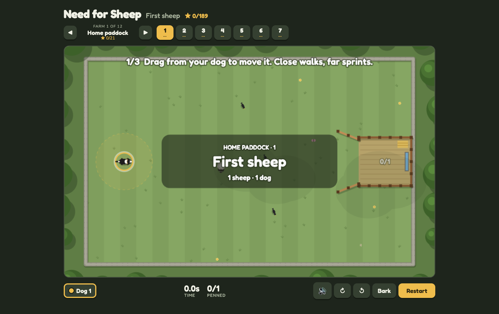

# Need for Sheep

### ▶ [Play Need for Sheep in your browser](https://louisvandenbruwaene.github.io/need-for-sheep/)

No install, no account: open the link and play. Drag from your dog to move it: close walks, far sprints. Level 1 walks you through it.

[](https://louisvandenbruwaene.github.io/need-for-sheep/)

Need for Sheep: herd the flock into the pen with your sheepdog, and sort ewes from lambs. 63 levels over twelve farms, from a single sheep in a walled paddock to a hundred and fifty driven the length of a valley, through night, fog, snow and storm, with a wolf about, and a full sheepdog trial to finish. One HTML file plus five sound clips in [`audio/`](audio), no build step: open [`index.html`](index.html).

Fields are zoomed out until they fit the screen. A field too big for that is seen through a camera that follows your dog, with a map in whichever corner of the screen is clear of the pens, the flock and the dogs: tap the map to send the dog there on its own, the way a shepherd sends a dog on its outrun. A sent dog keeps going while you switch to the other one.

Most levels give you one dog. A second dog appears only where you need it to block off somewhere the flock would get stuck (a side yard, an old quarry, a gateway to nowhere); a pulsing ring shows where to park it.

Two levels carry a three-step tutorial: the first level teaches herding, Shepherd's test teaches splitting a flock with a bark. Each prompt points at where to go and moves on once you have done it.

Sheep squash together but never through each other: each has a solid core half the size of its wool. They keep together, too: on an open field one that loses sight of the flock walks back to the nearest flockmate, and penned sheep amble to the back of the pen so the gateway stays clear for the rest. A pen is either flush against a wall or edge, or has plenty of room round it, so no sheep wedges itself behind one.

**All weathers** changes what you see: at night only your dog's light and the pen lanterns show the field (and sheep eyes shining in the dark), fog closes in round the dog, snow fills with tracks, and in a storm every clap of thunder spooks the flock. In **Wolf country** a wolf slips out of the woods now and then and scatters the flock: run your dog at it, or bark near it, and it bolts back to its den. On **The ram** farm a stubborn ram will not be rushed: sprint at him and he digs in, walk up close and he moves, and the ewes follow wherever he goes.

**Trial day** is a real sheepdog trial: pairs of hurdles (fetch, drive and cross-drive gates) that three quarters of the flock must pass between, each with a counter, and the pen stays padlocked until the course is done.

The field is alive: sheep graze, blink, chatter in speech bubbles and now and then faint when barked at; crows peck about, scatter when the dog comes and sometimes ride on a sheep's back; cloud shadows drift over; mud takes footprints. Each farm has its own light. A full pen bounces, the last sheep in sets off confetti, and the results card adds up how far your dog ran.

Controls: drag to run the dog (close to walk, far to sprint) or arrow keys / WASD with Shift to sprint. Space barks. Hold Q (come bye) or E (away to me) and the dog circles the nearest bunch of sheep clockwise or anticlockwise, the way a shepherd whistles a dog round its flock; the ↻ and ↺ buttons do the same on touch. Tab or right-click switches dog, 1-3 picks one. P or Esc pauses (so does leaving the window), R restarts, M mutes, G hides the ghost, Enter goes on from the results.

Sorting pens are labelled EWES or LAMBS. They take any sheep but only count their own kind, and a sheep in the wrong pen stays free to be driven out. A gate swings shut once its pen holds every sheep it needs. Your best run on each level comes back as a ghost dog to race.

## Play on this Mac

```
./app/install_app.sh   # puts Need for Sheep in /Applications
./app/make_icon.sh     # only needed after editing app/icon.html (also writes the web favicon)
```

The icon is a PixelLab mascot (`app/mascot.png`: a grinning collie with an unimpressed sheep on its head) on a sunburst tile. The app opens the game in its own Brave window. The folder path is baked in, so re-run `install_app.sh` if this folder moves.

## Online leaderboard

After a win, **Leaderboard** lets the player send their time under a name and shows the top five for that level (best time per name). Each time carries its run's dog paths: tap a row to race that ghost. Scores live in a free [Supabase](https://supabase.com) project:

1. Create a project, open **SQL Editor**, paste [`leaderboard.sql`](leaderboard.sql) and run it (re-running it on an existing project updates its checks and floors).
2. In **Project Settings > API**, copy the project URL and the `anon` public key into `const BOARD={url:'',key:''}` in `index.html`.

The anon key is meant to be public: row-level security lets visitors only add a time (above a per-level floor) and read the board. While `BOARD.url` is empty the button stays hidden.

## Level tools

- `node tools/check.cjs` checks every layout: nothing starts inside a rock, wall or pen, and the ground beside each pen is either shut or at least 160 px open.
- `node tools/bot.cjs [levelId ...]` plays levels with the game's own simulation, trying a few styles from careful to bold (with and without barking at strayed lambs), and prints its best time beside each level's star times. On a level with a `blocker` spot it parks dog 2 there first; when a wolf is about it runs the nearest dog at it; on a trial course it drives the flock through each pair of hurdles in turn before the pen.
- `node tools/par.cjs [levelId ...]` runs the bot without time limits and writes star times, time limits and leaderboard floors back into `index.html` and `leaderboard.sql`: gold 1.5x the bot (1.3x on sorting levels, 1.0x on flocks of 40 or more, which the bot herds in pieces), the other star 1.4x gold, the limit 1.4x that. A level the bot cannot finish keeps its numbers and is listed, so look at it: the bot still struggles with sheep pinned in corners.
